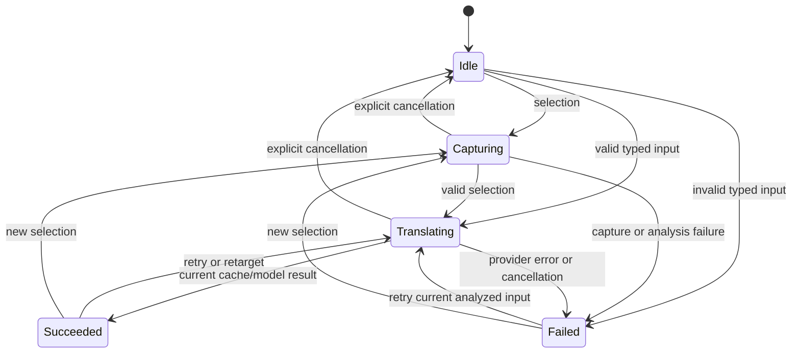

# State machines in Huaci

Asynchronous work belongs to an attempt and to the configuration chosen when it starts. Each owner checks that identity before committing results, clearing another operation's handle, or sending credentials. Mutually exclusive phases use Swift enums; independent UI flags and OS-owned status remain local.

This inventory covers the app and core Swift sources, including the shared SSE parser added during remediation. AX means **agent experience** here; macOS Accessibility is named explicitly. It is a source-level inventory with regression coverage, not an exhaustive proof of every OS interleaving.

## Remediated findings

| Boundary | Implemented behavior | Evidence |
| --- | --- | --- |
| Translation lifecycle | Explicit idle/capturing/translating/succeeded/failed states. Retry captures the newest input synchronously and retains cache policy. Failed new input clears older retry context. | [TranslationFlowTests](../Tests/HuaciCoreTests/TranslationFlowTests.swift) |
| Late results and callbacks | Request identity is checked before cache/history/presentation, including after a reentrant success callback. Provider cancellation ends visible loading; replaced requests remain silent. | `cancelledResultCannotPopulateCache`, `successCallbackCancellationSuppressesPresentation`, `providerCancellationEndsLoading` |
| Clipboard ownership | Copy transactions serialize. Snapshot versions must remain stable before posting. The first observed copy version is pinned; version gaps or later owners are rejected without restoring over them. Delayed data may fill that same version. | [SelectionCaptureTests](../Tests/HuaciCoreTests/SelectionCaptureTests.swift), including `newUserCopyAfterObservedClearIsNeverAdopted` |
| Clipboard cancellation and restoration | Once Command-C is posted, bounded cleanup runs independently of caller cancellation. Confirmed empty selections do not trigger copy; unknown Accessibility results retain fallback. Held modifiers and restore failure have explicit outcomes. | Cancellation/overlap tests; [SystemPasteboardTests](../Tests/HuaciCoreTests/SystemPasteboardTests.swift) calibrate native version counting and multi-item restoration on private pasteboards |
| OAuth callback framing | Read complete bounded HTTP headers across fragments. Ignore incidental/empty callbacks. Limit connections and lifetime; stop/cancellation closes listeners and accepted connections. Enforce one start and one waiter. Browser copy acknowledges receipt without claiming successful authentication. | [OAuthCallbackServerTests](../Tests/HuaciCoreTests/OAuthCallbackServerTests.swift), real local sockets |
| OAuth callback ownership | The production listener receives the expected state and rejects mismatches before claiming its callback. A late redirect from an older browser tab cannot consume the current sign-in. Session-level state validation remains. | `staleCallbackDoesNotConsumeTheCurrentSignIn` in [OAuthTests](../Tests/HuaciCoreTests/OAuthTests.swift) |
| Authentication completion and cleanup | Sign-in and refresh each have attempt identities. Replacement/sign-out stops obsolete sign-ins and refreshes; old cleanup cannot clear a newer task handle. | Abandoned/replaced sign-in and 20-interleaving refresh tests |
| Credential persistence | A failed refresh-token save is reported. Rotated tokens remain in memory for another save attempt, avoiding reuse of an invalidated old refresh token. Successful persistence or sign-out clears the pending value. | `failedRefreshPersistenceIsReportedAndRetriedWithoutTokenExchange`, `signOutDiscardsUnsavedRefreshedTokens` |
| Provider completion and SSE | Parse blank-line-delimited SSE events with multiline data. ChatGPT requires completed output, or response.done with completed status; completed-without-output still uses deltas. Antigravity requires STOP and rejects incomplete/rejected finishes. | [OAuthTranslatorTests](../Tests/HuaciCoreTests/OAuthTranslatorTests.swift), [ServerSentEventsTests](../Tests/HuaciCoreTests/ServerSentEventsTests.swift) |
| Provider discovery and version cache | Project/onboarding/model requests share refresh-on-401. Entitlement retry is limited to explicit entitlement/userTier rejection on HTTP 400; cancellation, transport, quota, and unrelated failures propagate. A stored project remains usable during compatible discovery outages. Version probes share in-flight work, stamp successful freshness after completion, and throttle failed probes for 60 seconds. | [ProviderDiscoveryTests](../Tests/HuaciCoreTests/ProviderDiscoveryTests.swift), [ModelCatalogTests](../Tests/HuaciCoreTests/ModelCatalogTests.swift) |
| Output parsing | Quote-aware balanced-object extraction rejects truncated/adjacent structured replies while preserving plain prose containing placeholders such as `{name}`. Explicit malformed root objects remain errors. | [ResultParserTests](../Tests/HuaciCoreTests/ResultParserTests.swift) |
| Configuration feedback | Connection tests and catalogs have separate configuration/attempt identities. Endpoint/key/account/service changes invalidate stale results; a selected-model edit clears test feedback without discarding a model-independent catalog. Failed key saving prevents testing the old key. | [ConfigurationLifecycleTests](../Tests/HuaciTests/ConfigurationLifecycleTests.swift) |
| Credential destinations | Personal API catalogs require explicit refresh. Refresh/test actions retain the chosen revision; later edits cannot redirect their credentials. Translation submissions also retain their service revision before scheduling. | [CatalogPrivacyTests](../Tests/HuaciTests/CatalogPrivacyTests.swift) mounts the real picker, intercepts HTTP, and uses a temporary synthetic key |
| Model suggestions | Local suggestions carry provenance and are labeled as unconfirmed. A server-listed model remains confirmed even if its display name comes from a local lookup. The icon menu has an accessible name. | Core provenance tests and native service-settings renders |
| Login forms | Service changes cancel collapsed onboarding work; separate forms have distinct SwiftUI identities. Identity-owned deferred cleanup runs on every login task exit, including cancellation and early returns. | Source ownership checks, auth cancellation regressions, onboarding render |
| Shortcut recorder | A session belongs to one originating window. Resignation, app deactivation, replacement recording, or disappearance restores exactly once. Other-window events pass through. Handler-installation and rollback failures are reported honestly. | [NativeLifecycleTests](../Tests/HuaciTests/NativeLifecycleTests.swift), including the handler installed by `start()` with real NSWindow/NSEvent objects |
| Popup lifetime and geometry | Close always releases flow, timer, speech, and monitors. Pinned resizing/display changes clamp to a visible screen. Favorites follow data changes; selected-text Command-C is preserved; same-app middle clicks dismiss consistently. | [PopupPositionerTests](../Tests/HuaciCoreTests/PopupPositionerTests.swift), source checks and popup renders |
| Durable storage UI | Query errors differ from empty data. Healthy rows remain available with row-ID decode warnings. Failed deletes/clears preserve rows and selection; version/count updates occur after success. Unknown counts do not display as zero. History explicitly states its 500-row scope, while search covers the whole database. | [StorageLifecycleTests](../Tests/HuaciTests/StorageLifecycleTests.swift), including injected read/write failures and 501-row search |
| History/favorite write feedback | A failed history save preserves the translation and reports that history was not saved. Failed favorite writes preserve the last known badge state and display the error. Successful retry clears the error. | [AppStorageFeedbackTests](../Tests/HuaciTests/AppStorageFeedbackTests.swift), injected SQLite triggers |
| SQLite boundaries | Explicit UTF-8 lengths preserve embedded NULs. Every bind status is checked; failed preparation finalizes its statement. Migrations are transactional and only acquire a writer lock for old schemas. Failed initialization closes its connection. | [HistoryStoreTests](../Tests/HuaciCoreTests/HistoryStoreTests.swift), including NUL identity, corrupt payload, rollback, and writer-lock cases |
| Accessibility and speech | Dynamic status announcements; hints allow 4–12 seconds and remain until dismissed under VoiceOver; Reduce Motion uses static loaders; speech controls show Stop. Stale utterance callbacks cannot clear a replacement utterance. | Native lifecycle tests with a silent synthesizer, native UI renders; live VoiceOver/audio limits below |

The failure cases for stale retry, late cache writes, cancelled credential completion, refresh replacement, embedded-NUL identity, provider completion, callback fragmentation, endpoint-edit requests, queued translation destinations, and unreported durable writes were reproduced before their fixes. A new test or rendered check is evidence for its named boundary, not a claim of complete OS coverage.

## Translation and credential ownership

[TranslationFlow.swift](../Sources/HuaciCore/TranslationFlow.swift) exposes `State`: `idle`, `capturing(UUID)`, `translating(UUID)`, `succeeded(UUID)`, and `failed(UUID, FlowError)`. `currentRequestID` is derived from state. Success/failure retain identity; explicit flow cancellation clears it. Provider cancellation of the still-current request produces a terminal cancelled error and ends loading. The popup and typed-input flows remain independent.



A new request can replace any phase. Cancellation retains valid retry context until another input/selection replaces it. [AppModel](../Sources/Huaci/AppModel.swift) separately records the service revision at each translation/retry/retarget action. A revision change before translator creation cancels that request instead of sending a saved key to the newly edited address. Cache hits retain the existing cross-service cache semantics and require no credentials.

[ConfigurationLifecycle](../Sources/Huaci/AppModel.swift) invalidates stale feedback immediately. Invalidation does **not** authorize a request to a newly typed host. Personal API model discovery requires Refresh; connection testing requires Test. Both capture the revision at the user action, and the model checks it again before creating immutable request configuration. OAuth providers have fixed service endpoints and retain automatic discovery after sign-in.

## Application and UI inventory

| Machine | Owner | States and transition events |
| --- | --- | --- |
| Launch | [main.swift](../Sources/Huaci/main.swift), [AppDelegate](../Sources/Huaci/AppDelegate.swift) | Not started → model/router/menu/hotkey ready → onboarding or menu-only |
| Menu attention | `AppDelegate`, `AppModel` | Ready ↔ permission/shortcut/service attention; derived notifications and OS polling |
| Preferences and active service | [AppSettings](../Sources/Huaci/AppSettings.swift) | Defaults → edited/persisted values; Personal API / ChatGPT / Antigravity |
| Data availability and invalidation | `AppModel` | Opening → available/error; data version N → N+1 after successful changes; durable write → success/error notice |
| Regular windows and tabs | [WindowRouter](../Sources/Huaci/WindowRouter.swift), [MainWindowView](../Sources/Huaci/MainWindowView.swift), [SettingsView](../Sources/Huaci/SettingsView.swift) | Absent → created → visible/hidden; translate/history/vocabulary; explicit settings tab enum. Retained windows are not destroyed on close. |
| Typed editor/result/import | [TranslateView](../Sources/Huaci/TranslateView.swift), `AppModel` | Idle → loading → result/error; edit/clear/target override; importing a result cancels old work and adopts its target |
| Popup content and visibility | [PopupController](../Sources/Huaci/PopupController.swift), [PopupView](../Sources/Huaci/PopupView.swift) | Hidden ↔ loading/result/error/hint; close cleans resources even while hidden |
| Popup monitors, pin, and layout | `PopupController`, [PopupPositioner](../Sources/HuaciCore/PopupPositioner.swift) | Outside click/Escape → close; unpinned ↔ pinned/dragged; resize/display change → clamped frame |
| Hint timer | `PopupController` | Hint → replacement/explicit close/reading-time expiry; VoiceOver disables automatic expiry |
| Copy and favorite feedback | `PopupController`, `TranslateView`, [LibraryViews](../Sources/Huaci/LibraryViews.swift) | Uncopied → copied → result reset; favorite absent/present → mutation success or preserved state with error; data changes refresh badges |
| Source disclosure and error recovery | [ResultViews](../Sources/Huaci/ResultViews.swift) | Collapsed ↔ expanded; terminal error → hint/warning/error and contextual recovery action |
| Onboarding | [OnboardingView](../Sources/Huaci/OnboardingView.swift) | Service → permission → practice → completed; setup-later path remains intentional |
| Permission and practice | `OnboardingView`, `AppModel` | Untrusted ↔ trusted; baseline popup count → newer successful result; only newly granted access auto-advances |
| Onboarding/settings login | `OnboardingServiceRow`, `OAuthServiceForm` | Signed out → browser pending → signed in/error/cancelled; selected row/form and attempt ID own cleanup |
| API key draft | [ServiceConfigurationView](../Sources/Huaci/ServiceConfigurationView.swift) | No saved key / saved key / replacement draft → save/delete success or visible error; unsaved draft prevents catalog discovery |
| Connection test | `ConfigurationLifecycle`, `ServiceConfigurationView` | Untested → testing → success/failure; revision change → invalidated; stale completion → dropped |
| Model picker/catalog | `ConfigurationLifecycle`, `ModelPicker` | Local suggestions → explicit personal/fixed-provider discovery → remote list/error; manual refresh owns a revision and unique request ID |
| Shortcut recording | [ShortcutRecorder](../Sources/Huaci/ShortcutRecorder.swift) | Idle → recording in owning window → accept/invalid/Escape/reset/resignation/deactivation → cleanup |
| Global hotkey | [HotKeyCenter](../Sources/Huaci/HotKeyCenter.swift), `AppModel` | Unregistered → handler installed/registration success/error; suspended → restored or explicit rollback failure |
| Login item and OS permissions | `SettingsView`, `AppModel` | OS-reported disabled/enabled/approval-required/not-found/error; trusted/untrusted; periodic refresh |
| History/vocabulary query and selection | `LibraryViews.LibraryListState` | Not loaded/healthy/filtered/empty/read error/partial decode warning; valid/nil selection; failed reads retain prior rows |
| Delete and clear | `LibraryListState`, `SettingsView.StorageDataState` | Target confirmation → cancel/mutation; success updates rows/counts/version; failure preserves prior data and reports error |
| Speech | [Speech](../Sources/Huaci/Speech.swift), shared result controls | Idle ↔ active utterance; new utterance stops old; finish/cancel only clears matching utterance; Stop is available on each result surface |
| Hover/press/loading motion | [Theme](../Sources/Huaci/Theme.swift), `PopupView` | Local idle/hovered/pressed state; animated/static loading chosen by Reduce Motion |

## Core and provider inventory

| Machine | Owner | States, events, and guards |
| --- | --- | --- |
| Selection and clipboard transaction | [SelectionCapture](../Sources/HuaciCore/SelectionCapture.swift), [SystemIntegration](../Sources/HuaciCore/SystemIntegration.swift) | Permission/PID check → Accessibility read → known text/known empty/unknown; unknown → serialized modifier wait/snapshot/copy/poll/pinned-version restore; explicit cancellation/error outcomes |
| Pasteboard snapshot | `SystemPasteboard` | Enumerate/materialize all items/types → snapshot or unreadable/64-MiB limit; prebuild items before restore; native restore success/failure |
| Translation coordinator (two instances) | `TranslationFlow` | Idle/capturing/translating/succeeded/failed with current request ID and immutable retry context |
| Browser sign-in | [OAuthSession](../Sources/HuaciCore/OAuth.swift) | Client check → expected state/PKCE → listener → browser → matching callback → code exchange → account discovery → owned credential commit |
| Token refresh/persistence/sign-out | `OAuthSession` | Missing/fresh/expiring → identity-owned shared refresh → persisted/error with pending rotated tokens; retry persistence or clear on sign-out |
| Callback listener and waiter | [OAuthCallbackServer](../Sources/HuaciCore/OAuthCallbackServer.swift) | One start → ready/failure/cancellation → stopped; one waiter → current matching callback or terminal failure; first accepted result wins |
| Callback connection | `OAuthCallbackServer` | Accepted → bounded fragmented header → validated route/shape/state → response/close; idle/oversized/truncated connections close without consuming a valid callback |
| Timeout race | `OAuth.withTimeout` | Operation/timer running → first result/error → cancel sibling → return; child must cooperate with cancellation |
| Authenticated resource request | [ChatGPTTranslator](../Sources/HuaciCore/ChatGPTTranslator.swift), `OAuthSession.send` | Valid token → request → first 401 → forced refresh → one retry → result/error |
| Personal API request | [Translators](../Sources/HuaciCore/Translators.swift) | Validate endpoint/key/model/input → JSON-format request → one compatible format fallback → parse/error |
| SSE frame and provider output | [ServerSentEvents](../Sources/HuaciCore/ServerSentEvents.swift), ChatGPT/Antigravity translators | Collect data lines → empty-line dispatch; deltas/candidate text → verified terminal success or failure; incomplete EOF is rejected |
| Antigravity account/project | [AntigravityTranslator](../Sources/HuaciCore/AntigravityTranslator.swift) | Account lookup/project/tier load → known project or bounded onboarding → ready/error. Known-project fallback preserves outage compatibility; auth/cancellation/quota errors propagate. |
| Model discovery/entitlement | [ModelCatalog](../Sources/HuaciCore/ModelCatalog.swift) | Fetch/decode/filter/rank → confirmed models or marked suggestions; only an explicit HTTP-400 entitlement rejection tries another tier |
| Antigravity version | `AntigravityVersion` | Fresh value / stale → shared probe → validated success with six-hour TTL, or previous/fallback value with 60-second retry throttle |
| Result parsing | [ResultParser](../Sources/HuaciCore/ResultParser.swift) | Structured-object attempt → balanced string-aware scan/decode/normalize → result/error; ordinary prose preserves braces |
| Keychain adapter | [Keychain](../Sources/HuaciCore/Keychain.swift), `KeychainCredentialStore` | Read present/missing/inaccessible; update/insert/delete. OS-read errors still collapse to absence in the optional read API; refresh persistence failure is explicit. |
| SQLite connection/schema | [HistoryStore](../Sources/HuaciCore/HistoryStore.swift) | Open → current schema or transactional migration → available/error → close. Current-schema opening does not acquire a migration writer lock. |
| SQLite statement | `HistoryStore.prepare/query/write` | Prepare → checked explicit-length binds → step/map → finalize; errors preserve ownership and close/finalize resources |
| History/favorite/cache records | `HistoryStore` | Append/delete/clear; absent/saved/updated/removed; cache miss/insert/replace/clear. Snapshot readers retain healthy rows with decode warnings; strict readers throw. |

`TextAnalyzer` tracks local scanner state while classifying mixed scripts; `DayGrouping` flushes accumulated items at day changes. `Models`, `Prompts`, shortcut validation/conversion, and error-message mappings are pure data/transformations. They do not need asynchronous state-machine infrastructure.

## Deliberate semantics and platform limits

- Cache identity remains text + kind + target, spans services/models, and survives history clearing. Favorites remain headword + target and preserve original save time on update. These are existing product semantics; no identity migration was introduced.
- Cache access is optional: lookup/write errors do not block a translation, and a fresh result can replace an unreadable cached payload. Durable history/favorite failures are visible separately.
- macOS exposes pasteboard ownership versions, not a reliable writer identity or atomic compare-and-restore operation. Huaci rejects version gaps and subsequent owners, but cannot prove the source of a single otherwise indistinguishable external write. Cleanup after a dispatched copy is bounded by the existing copy timeout; a source app writing later than that remains a hardware/app compatibility case.
- Unsupported Accessibility selection attributes cannot prove whether text is selected. Confirmed empty text avoids copying an editor line; unknown cases preserve the compatibility fallback and require cross-app checks.
- Historical cache rows already overwritten by the former embedded-NUL collision cannot be reconstructed. Explicit cache clearing remains available; this patch does not automatically delete stored data.
- Failed persistence of rotated credentials retains recovery only for the current process. The error instructs the user to restore Keychain saving before quitting; sign-out intentionally discards pending credentials.

## Verification

Use the documented Xcode toolchain:

```sh
export DEVELOPER_DIR=/Applications/Xcode.app/Contents/Developer
swift test
swift build -c release
```

Final integration verification passed **227 tests across 28 suites**: 194 core tests in 22 suites and 33 app tests in 6 suites. `swift build -c release` also succeeded. The documented Xcode toolchain and default build system were used for both complete test targets and the release build. The previous pass had 128 core tests.

[AppRenderingTests](../Tests/HuaciTests/AppRenderingTests.swift) and storage lifecycle rendering use temporary preferences, temporary SQLite databases, and unique Keychain namespaces. [CatalogPrivacyTests](../Tests/HuaciTests/CatalogPrivacyTests.swift) adds a temporary synthetic key and records requests through an injected URLSession; the item is removed afterward. Other provider calls are stubbed. Socket tests use local ephemeral ports; pasteboard tests use private named boards. No paid provider or existing saved credential is needed.

Set `HUACI_UI_TEST_ARTIFACTS=/tmp/huaci-ui-verification` when running `swift test` to save offscreen screenshots. The checked surfaces include main translation/history, service/data settings, local model suggestions, onboarding, popup result/loading/error/hint/word/storage warning, and durable-storage query/decode/count failures. Bitmap creation is a rendering smoke check; screenshots are separately inspected for visible content and layout.

Recorder tests use the installed event handler with real NSWindow/NSEvent objects and the native local-monitor registration API, without sending physical keystrokes. Speech replacement tests use a silent synthesizer and late delegate callbacks. Live VoiceOver announcements, audible voice quality, physical multi-display dragging, and cross-app clipboard timing remain manual compatibility checks in [compatibility.md](compatibility.md).
